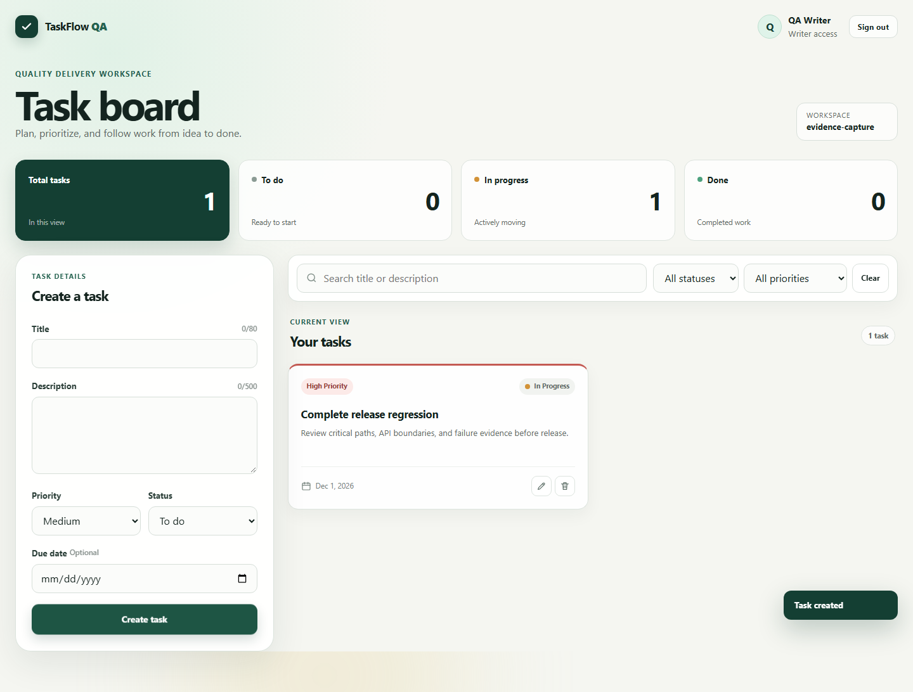
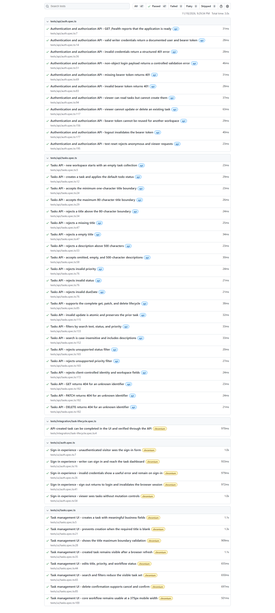
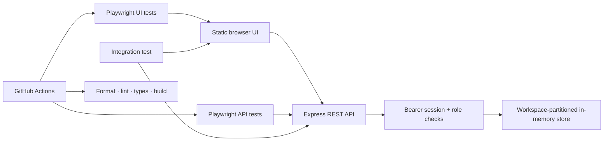

# TaskFlow QA — QA Engineering Portfolio

TaskFlow QA is a production-style software testing portfolio built around a small, local task-management application. The repository shows evidence of test planning, manual test design, UI and API automation, authorization testing, boundary analysis, traceability, debugging, reporting, and CI design—instead of only listing those skills.

The application is intentionally modest. The QA engineering is the main product.

## Verified Local Result

**47 unique automated tests passed twice (94/94 repeat executions) on 18 November 2026.**

| Verification area                   |                                       Actual local result |
| ----------------------------------- | --------------------------------------------------------: |
| API tests                           |                                              33/33 passed |
| Chromium UI tests                   |                                              13/13 passed |
| Chromium integration test           |                                                1/1 passed |
| Default regression                  |                                        47/47 passed twice |
| WebKit UI tests                     |                                              13/13 passed |
| Firefox UI tests                    | 0 executed—browser launch blocked by this Windows sandbox |
| Lint, formatting, type-check, build |                                                    Passed |
| GitHub Actions                      |                       Configured, not yet run or verified |

These runs overlap and are not added together as unique coverage. See the exact environment, commands, limitations, and evidence in the [test execution report](docs/TEST_EXECUTION_REPORT.md).





## What This Project Demonstrates

- A risk-based test plan with entry/exit criteria, scope, priorities, and environmental risks.
- 45 manual cases covering positive, negative, boundary, authorization, query, isolation, operability, accessibility, and responsive scenarios.
- Boundary value analysis for 1/80/81-character titles and 500/501-character descriptions.
- Equivalence partitions for roles, task states, priorities, dates, authentication, and invalid identifiers.
- Playwright API testing for authentication, authorization, CRUD, validation, filters, error contracts, and data isolation.
- Playwright UI testing with Page Objects, accessible locators, reusable fixtures, and no fixed waits.
- An API → UI → API integration lifecycle test.
- Per-test workspace isolation, scenario-owned data, and a guarded test reset endpoint.
- HTML and JUnit reporting, failure screenshots, video, and traces.
- A GitHub Actions pipeline that gates formatting, lint, types, build, API, UI, integration, Firefox, and WebKit.
- Honest evidence: manual work is not marked executed, Firefox is reported as blocked, and CI is not claimed as green before publication.

## Application Under Test

TaskFlow QA supports:

- writer and read-only viewer accounts;
- server-side bearer sessions and logout invalidation;
- session-bound workspace isolation;
- task create, read, update, and delete workflows;
- title, description, priority, status, and due-date validation;
- title/description search plus status and priority filters;
- a test-only, writer-authorized workspace reset;
- an in-memory store for fast, deterministic local execution.

The application was selected after comparing SauceDemo, RealWorld/Conduit, and a purpose-built local system against ten portfolio criteria. Read the scored decision in [Application Selection](docs/APPLICATION_SELECTION.md).

## Architecture



The `X-Workspace-Id` chosen at login becomes part of the server session. Reusing that token with another workspace is rejected with `403`, so the header is not trusted as an ownership shortcut. Full design details are in [Architecture](docs/ARCHITECTURE.md).

## Technology Stack

| Area              | Technology                                   |
| ----------------- | -------------------------------------------- |
| Language          | TypeScript                                   |
| Application       | Node.js, Express, static HTML/CSS/JavaScript |
| UI/API automation | Playwright Test and `APIRequestContext`      |
| Design pattern    | Page Object Model plus custom fixtures       |
| Reports           | Playwright HTML and JUnit                    |
| Quality gates     | ESLint, Prettier, TypeScript                 |
| CI                | GitHub Actions                               |
| Documentation     | Markdown and Mermaid                         |

## Quick Start

Requirements: Node.js 20 or newer and npm.

```bash
git clone <repository-url>
cd qa-engineering-portfolio
npm ci
npm run browsers:install
npm run test:regression
```

Open the application for exploration:

```bash
npm run dev
```

Then visit `http://127.0.0.1:4180`.

### Local demo accounts

| Role   | Email                 | Password     | Permissions           |
| ------ | --------------------- | ------------ | --------------------- |
| Writer | `writer@example.test` | `Writer123!` | Read and mutate tasks |
| Viewer | `viewer@example.test` | `Viewer123!` | Read only             |

These are deliberately public local-demo values, not production credentials.

## Commands

| Command                      | Purpose                                   |
| ---------------------------- | ----------------------------------------- |
| `npm run lint`               | Lint source and tests                     |
| `npm run format:check`       | Verify formatting without changing files  |
| `npm run typecheck`          | Run strict TypeScript checks              |
| `npm run build`              | Compile the application to `dist/`        |
| `npm run test:api`           | Run 33 API tests                          |
| `npm run test:ui`            | Run 13 Chromium UI tests                  |
| `npm run test:integration`   | Run the cross-layer lifecycle             |
| `npm run test:regression`    | Run the 47-test API + Chromium baseline   |
| `npm run test:ui:webkit`     | Run the UI suite in WebKit                |
| `npm run test:ui:firefox`    | Run the UI suite in Firefox               |
| `npm run test:cross-browser` | Run UI tests in all three browser engines |
| `npm run report`             | Open the latest regression HTML report    |
| `npm run evidence:capture`   | Recreate the two tracked screenshots      |

The test scripts use [`scripts/run-tests.mjs`](scripts/run-tests.mjs) to start the app, wait for readiness, run Playwright, and stop only the process they own. This makes local and CI lifecycle behavior explicit and cross-platform.

## Automated Coverage

### API

- health and structured error responses;
- valid, invalid, blank, and non-object login input;
- missing and invalid bearer tokens;
- writer/viewer role permissions for create, update, and delete;
- token invalidation at logout;
- cross-workspace token reuse denial;
- writer-only test reset authorization;
- GET, POST, PATCH, and DELETE lifecycle;
- title and description boundaries;
- invalid priority, status, date, query, and client-controlled identity fields;
- atomic rejected updates;
- case-insensitive title/description search and combined filters;
- unknown identifiers.

### UI

- anonymous, writer, invalid, and viewer sign-in states;
- real server-side sign-out;
- meaningful task creation and refresh persistence;
- blank and overlength title feedback;
- edit, status, and priority changes;
- search and combined filters;
- delete cancel and confirmation;
- a 375px mobile-width usability smoke check.

### Integration

One scenario creates a task through the API, completes it in the browser, and verifies the final state through the API. This checks the contract between layers without duplicating the whole UI suite.

## Manual QA and Traceability

Manual cases remain `Planned / Not executed`; automated evidence is recorded separately.

- [Requirements](docs/REQUIREMENTS.md)
- [Test Plan](docs/TEST_PLAN.md)
- [Test Strategy](docs/TEST_STRATEGY.md)
- [Manual Test Cases](docs/TEST_CASES.md)
- [Requirements Traceability Matrix](docs/REQUIREMENTS_TRACEABILITY.md)
- [Exploratory Testing Charters](docs/EXPLORATORY_TESTING.md)
- [Defect Log and Template](docs/BUG_REPORTS.md)

No genuine product defect remained in the final executed automation. The Firefox launch failure is recorded as an infrastructure limitation, not misreported as an application defect.

## CI/CD

The workflow at [`.github/workflows/tests.yml`](.github/workflows/tests.yml) performs:

1. reproducible installation with `npm ci`;
2. formatting, lint, type-check, and build gates;
3. API, Chromium UI, and integration runs;
4. Firefox and WebKit UI jobs;
5. upload of HTML, JUnit, screenshot, video, and trace evidence when present.

No status badge is shown because the repository has not been published and GitHub Actions has not yet produced a real status. See [Publishing Guide](docs/PUBLISHING_GUIDE.md).

## Learning and Interview Support

- [Setup Guide](docs/SETUP_GUIDE.md) — installation and commands.
- [Learning Guide](docs/LEARNING_GUIDE.md) — simple explanations grounded in this code.
- [Interview Guide](docs/INTERVIEW_GUIDE.md) — 30-second, two-minute, and five-minute walkthroughs plus Q&A.
- [Hiring Manager Review](docs/HIRING_MANAGER_REVIEW.md) — strengths, honest weaknesses, and the next three improvements.

## Known Limitations

- Tasks and sessions are in memory and disappear when the server restarts.
- Authentication uses documented demo users, not production identity infrastructure.
- Application and tests live in one repository and were developed together.
- Manual and exploratory cases have not been executed.
- Firefox could not start inside this Windows sandbox; the Linux CI job is configured but unverified.
- GitHub Actions and public repository metadata remain unverified until publication.
- This is functional regression evidence, not performance, penetration, or compliance certification.

## What I Learned

- Testability is an architectural concern: controllable state and isolated workspaces make reliable automation possible.
- A smaller suite with explicit business assertions is stronger than a large suite of shallow clicks.
- Requirements, manual cases, automated specs, and reports must describe the same behavior.
- Environment failures must be separated from product defects.
- Passing once is not enough; controlled data, owned process lifecycle, and repeat runs are essential to confidence.

## License

MIT. See [LICENSE](LICENSE).
