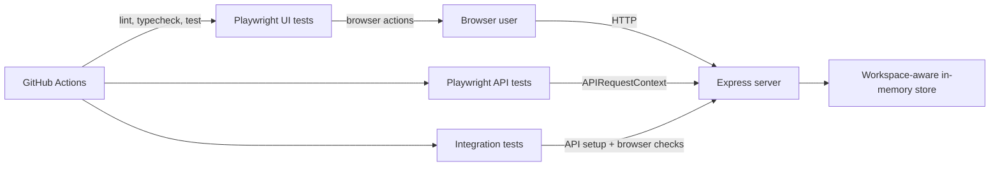

# TaskFlow QA Architecture

## Purpose

TaskFlow QA is a small task-management application built specifically to demonstrate practical quality engineering. The product is intentionally modest: the important part of this repository is the traceable test design, controlled data, reliable automation, diagnostics, and documentation around it.

The application and its tests live in one repository so a reviewer can clone one project, start one local server, and run the complete portfolio without paid services or credentials.

## System at a glance



The server has two outward-facing responsibilities:

1. It serves the static HTML, CSS, and JavaScript user interface.
2. It exposes the HTTP API used by both the UI and the automated API tests.

There is no separate database. Task records and bearer-token sessions are stored in process memory and disappear when the server restarts. That is a deliberate portfolio tradeoff, not a production-ready persistence or session design.

## Repository layers

| Area                 | Responsibility                                                   | Why it exists                                                                    |
| -------------------- | ---------------------------------------------------------------- | -------------------------------------------------------------------------------- |
| `app/`               | Express/TypeScript application and static browser UI             | Gives the test suite a safe, reproducible application under test                 |
| `pages/`             | Playwright Page Objects                                          | Keeps user interactions and locators out of scenario-focused UI tests            |
| `tests/api/`         | Direct HTTP tests through `APIRequestContext`                    | Verifies status codes, payloads, validation, access rules, and CRUD behavior     |
| `tests/ui/`          | Browser-level workflows                                          | Verifies the application as a user experiences it                                |
| `tests/integration/` | Checks that cross the API/UI boundary                            | Demonstrates that state created through one interface is visible through another |
| `tests/fixtures/`    | Shared Playwright setup and isolated context                     | Reduces repeated setup without hiding important behavior                         |
| `tests/support/`     | Small test utilities                                             | Centralizes low-level helpers that are not page behavior                         |
| `test-data/`         | Reusable, explicit test values/builders                          | Separates test intent from incidental data construction                          |
| `docs/`              | QA strategy, cases, traceability, results, and learning material | Provides reviewable evidence of the STLC, not only automation code               |
| `.github/workflows/` | Continuous-integration workflow                                  | Repeats quality gates in the published repository's clean hosted environment     |

See the source files in each directory for the final implementation names. This document describes responsibilities rather than treating filenames as an architectural boundary.

## Application design

### Task domain

A task is the central business object. The API owns its creation, validation, update, retrieval, and deletion. The UI is a client of that same API; it does not maintain an independent source of truth.

The implemented task fields and allowed values are defined in the TypeScript application types and validation code. Tests should use those definitions as a behavioral contract, while still asserting externally visible results rather than importing application internals into the test suite.

### Workspace isolation

Every test receives a unique workspace identifier and sends it through the `X-Workspace-Id` header. The store groups records by that identifier.

```text
test A -> X-Workspace-Id: workspace-a -> tasks for A only
test B -> X-Workspace-Id: workspace-b -> tasks for B only
```

This solves a common parallel-testing problem: one test can create or delete data without changing another test's data. It also removes the need to run scenarios in a fixed order.

Workspace IDs are test isolation, not real authentication. A production system would derive tenant identity from a trusted login token and enforce authorization on the server.

### Roles

The application demonstrates two business roles:

- `writer` can read and change tasks.
- `viewer` can read tasks but must not create, edit, or delete them.

`POST /api/auth/login` exchanges documented demo credentials for an in-memory bearer token. At login, the server binds that token to the supplied `X-Workspace-Id` and the user's role. Protected task endpoints require the token and matching workspace; trying to reuse it with another workspace returns `403`. Mutation routes also require the `writer` role. `POST /api/auth/logout` deletes the token, so later reuse is rejected. Sessions exist only in the current server process and also become invalid after restart.

The simple demo login is suitable for deterministic local testing, but it is not a replacement for production identity, password hashing, session expiry/revocation, or a trusted identity provider.

### In-memory data store

The store is fast and deterministic, and it requires no external service. Its limitations are explicit:

- all data is lost when the Node process stops;
- multiple server processes do not share state;
- it does not demonstrate migrations, transactions, or database failure handling;
- it is meant for learning and portfolio review, not real user data.

### Test-only reset behavior

A reset route is available only when `TEST_MODE` is enabled. It requires a valid writer bearer token. The automation sends its `X-Workspace-Id`, and the fixture calls the route without seed data, so that one controlled workspace is reset to an empty task collection. The application returns `404` for this route in normal mode.

This is defense in depth. Unique workspaces provide the main isolation; reset support makes local debugging repeatable. Test code should never depend on deleting another test's workspace.

## Important source files

| File                           | Responsibility                                                                                |
| ------------------------------ | --------------------------------------------------------------------------------------------- |
| `app/src/server.ts`            | Express configuration, static hosting, authentication middleware, routes, and error responses |
| `app/src/types.ts`             | Shared application-domain TypeScript types                                                    |
| `app/src/validation.ts`        | Create/update validation and filter enum parsing                                              |
| `app/src/store.ts`             | Workspace-partitioned in-memory task CRUD and optional demo seed data                         |
| `app/public/index.html`        | Accessible login, task form, filters, dialogs, and task-list structure                        |
| `app/public/app.js`            | Browser-side login state, API calls, rendering, filters, and task actions                     |
| `app/public/styles.css`        | Responsive visual presentation and visible interaction states                                 |
| `pages/LoginPage.ts`           | Sign-in locators and the login interaction                                                    |
| `pages/TasksPage.ts`           | Task-board locators plus create, edit, filter, and delete interactions                        |
| `tests/fixtures/test.ts`       | Unique workspace, authenticated API client, signed-in page, and task-page fixtures            |
| `tests/support/api-client.ts`  | Authenticated task API wrapper used by tests and setup                                        |
| `test-data/users.ts`           | Explicit non-production demo users and invalid-login data                                     |
| `test-data/tasks.ts`           | Task types, valid-data builder, and unique title helper                                       |
| `playwright.config.ts`         | Browser/API projects, base URL, reporters, and failure evidence policy                        |
| `package.json`                 | Reproducible npm commands, including project-local browser installation                       |
| `scripts/run-tests.mjs`        | Starts the app as a direct child, waits for `/health`, runs Playwright, and always stops it   |
| `scripts/capture-evidence.mjs` | Captures genuine dashboard and completed regression-report screenshots                        |
| `.github/workflows/tests.yml`  | Verified hosted quality gates and report uploads                                              |

## Test architecture

### API tests

API tests call the server directly with Playwright's `APIRequestContext`. They are the quickest layer for exercising:

- GET, POST, PATCH/PUT, and DELETE behavior that the application implements;
- valid and invalid payloads;
- missing fields, invalid identifiers, and boundary values;
- role-based access decisions;
- response status, body, and contract expectations.

Each scenario creates only the records it needs. Tests do not assume seeded tasks or execution order.

### UI tests

UI tests drive a real browser. They verify user-visible workflows and messages instead of repeating every API combination through the slower browser layer. Locators should prefer roles, labels, visible names, and intentional test IDs when a semantic locator is not practical.

The Page Object Model separates two concerns:

```text
Test:        describes the business scenario and assertions
Page object: knows how to locate and operate the page
```

Page Objects do not contain the whole test. Important expected results stay visible as assertions in the spec.

### Integration tests

Integration tests intentionally cross boundaries. A representative pattern is:

1. create controlled data through the API;
2. open the same workspace in the browser;
3. verify the task is rendered correctly;
4. change it through the UI when the scenario requires it;
5. verify the resulting state through the API.

This produces stronger evidence than testing either surface alone while avoiding slow browser setup for every data precondition.

### Fixtures and test data

Fixtures create the unique workspace and configured clients/pages that each test needs. Reusable data builders provide valid defaults while allowing a scenario to override the one field it is testing.

Good fixture behavior is visible and bounded. A fixture should not create unrelated business data or make assertions that surprise the reader.

## Reliability controls

- Tests use unique workspaces and can run independently.
- No scenario relies on another scenario's output.
- Playwright auto-waiting and assertion retrying replace fixed sleeps.
- The server and tests use configurable base URLs rather than hardcoded remote hosts.
- Failure screenshots, videos, and traces are retained according to Playwright configuration.
- HTML and JUnit reporters serve people and CI systems respectively.
- Linting and TypeScript checking run before or alongside tests.
- Cross-browser coverage is a separate practical command so the normal feedback loop stays fast.
- Browser binaries live in the ignored project-local `.playwright-browsers/` directory through the package scripts, avoiding reliance on a machine-global browser cache.
- Test scripts use `scripts/run-tests.mjs`, not Playwright's `webServer` option: it starts the TypeScript server directly on port `4180`, polls the health endpoint, forwards Playwright's exit code, and stops both child processes on completion or interruption.

## CI boundary

The workflow is designed to install dependencies reproducibly, install required Playwright browser binaries, run static checks, start the application, execute the suites, and upload diagnostic artifacts. It must fail when a required check fails.

The workflow was verified by successful [GitHub Actions run 44394380121](https://github.com/Mohamedatef27120/qa-engineering-portfolio/actions/runs/44394380121). Its quality-gates/Chromium, Firefox, and WebKit jobs passed on GitHub-hosted Ubuntu and uploaded three evidence artifacts. Local and hosted results remain distinct evidence sets.

## Verified local snapshot — 2026-11-18

| Check                                                    | Observed result                                                                                            |
| -------------------------------------------------------- | ---------------------------------------------------------------------------------------------------------- |
| Formatting, linting, type checking, and TypeScript build | Passed                                                                                                     |
| API project                                              | 33/33 passed                                                                                               |
| Chromium UI project                                      | 13/13 passed                                                                                               |
| Chromium integration project                             | 1/1 passed                                                                                                 |
| Full regression (API + Chromium UI + integration)        | 47/47 passed twice                                                                                         |
| WebKit UI project                                        | 13/13 passed                                                                                               |
| Firefox UI project                                       | 0 executed; blocked before application tests because this Windows sandbox denied registry access at launch |
| Evidence screenshots                                     | Genuine dashboard and 47-test regression-report screenshots captured by `npm run evidence:capture`         |

The Firefox observation is an environment launch blocker, not an application assertion failure and not a passing local result. The composite cross-browser command therefore was not fully green in this sandbox. Firefox was blocked only in the managed Windows sandbox; the GitHub-hosted Ubuntu Firefox job passed in Actions run 44394380121.

## Important tradeoffs

| Decision                        | Benefit                                                 | Cost / limitation                                                 |
| ------------------------------- | ------------------------------------------------------- | ----------------------------------------------------------------- |
| Build a small local application | Safe automation, controlled data, reproducible failures | Less feature depth than a mature third-party product              |
| In-memory storage               | No database setup; very fast reset                      | Data disappears on restart; no database testing                   |
| App and tests in one repository | One-command setup and easy code review                  | Less separation than an independent black-box QA repository       |
| Workspace header isolation      | Parallel, deterministic tests                           | Not production-grade tenant security                              |
| Simple roles                    | Clear authorization scenarios                           | Does not demonstrate a real identity provider                     |
| POM only for user interactions  | Readable, maintainable UI tests                         | Requires judgment; excessive abstraction is intentionally avoided |

## Safe extension points

Future improvements can add persistence, real authentication, richer task filtering, accessibility scanning, visual checks, or performance tests. Each addition should begin with a requirement and risk analysis. Adding tools only to increase the technology list would weaken the project's focus.
